# The Cat Show: a benchmark where the exam is a day of real work

The [Cat Show](glossary.md#the-cat-show) is a benchmark where the exam is a day of real work in a simulated town. Models are seated in the jobs that grade it, and the studies compare chairs by [relative strength](glossary.md#relative-strength-bulk-and-lean) on the same material: performance and cost, both measured. This is the first study.

The live page: [docs/the-cat-show/](docs/the-cat-show/), served at [https://gjames24.github.io/work/the-cat-show/](https://gjames24.github.io/work/the-cat-show/).

## 01 · Two seats. Three models. Five dials.

A benchmark where the exam is a day of real work. A town of residents lived a day on the wire, and models were seated in the jobs that grade it. This is what each seat found, what the [skeptic](glossary.md#the-skeptic) refused, what the [referees](glossary.md#a-referee) held, and what it cost. Stats: 15 (reader cells: three models at five dials); 10 (skeptic columns: two models at five dials); d101 · d100 (a [tape](glossary.md#the-tape-the-loom) per seat: d101 is day 101 of the town's record, d100 day 100).

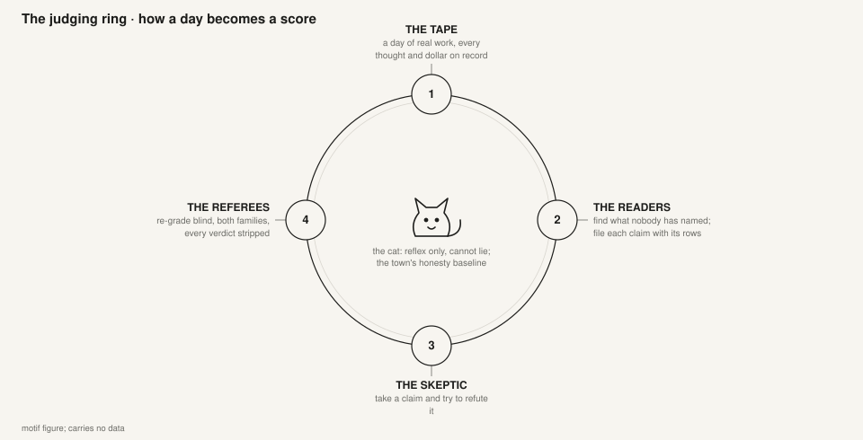

*the judging ring: how a day becomes a score; the motif of the rail; it carries no data*

## 02 · The exam is a day of real work, and the cat cannot lie.

Tilda is a simulated town whose residents think on the wire; every thought, act and dollar lands on a tape. The [Stray Cat](glossary.md#the-stray-cat), its examiner, grades those days. The Cat Show seats a model in each job the grading demands and asks how well, and at what price, it does it. Stats: d101 (the reader seat's tape · engine 8.55 (the tape's own launch line) and 8.56 (the exam room's reading)); d100 (the skeptic seat's tape · engine 8.55 (the tape and the exam room agree)).

The town's cat, reflex-only and unable to lie: the honesty baseline of the town's record. Every claim on this page was checked against the tape by a skeptic. On the reader seat only the rows the skeptic held reached the referees, two referee families; on the skeptic seat one family graded the rows a chair threw out.

- two stamps, one tape: 8.55 the tape's launch line, 8.56 the exam room's reading

- **[model](glossary.md#model)**: A language model under test. The page names each by its family and release, and sets models of different families and releases side by side.
- **[dial](glossary.md#dial)**: The effort setting a model runs at, from low to max: how much reasoning it may spend on a task.
- **[seat and chair](glossary.md#seat-and-chair)**: A seat is a job the exam demands; a chair is the model and dial seated in it.
- **[cell](glossary.md#cell)**: One model at one dial in one seat. Every figure in a table or on a figure's row belongs to one cell.
- **[claim](glossary.md#claim)**: A finding the reader files: a defect, an all-clear, or another kind.
- **[plant](glossary.md#plant)**: A row mixed in among the claims a chair grades, planted so the chair's blindness can be measured.
- **[held and distinct held](glossary.md#held-and-distinct-held)**: Held has three senses, in the order the page meets them: in the skeptic's cut, a row the skeptic chair confirmed as a defect; on the referee screens, a defect a blind referee upheld against the record; and on the skeptic seat, a refusal the referee upheld. Distinct held counts the different defects among the referees' held rows, each once, however many claims name it.
- **[cache-write token](glossary.md#cache-write-token)**: The unit a plan meters and charges: a token written to the model's cache. Every cost on this page is counted in them, or in the list dollars they cost.

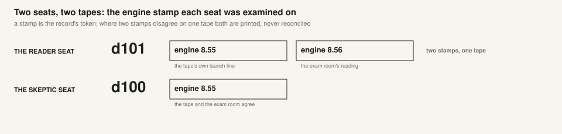

*two seats, two tapes: a stamp is the record's token; where two stamps disagree on one tape both are printed, never reconciled*

## 03 · Two jobs the exam demands, and who holds each chair.

A seat is a job, not a prompt. What this page says of a chair is the house's ruling copied as the record states it, never the page's own reading. Both seats are told the same way: the holder as ruled, the challenger ahead on a newer row, the owner's placement for use on that row, and the next sitting.

- **the reader**: HOLDER Fable 5.1 low, ruled by the owner 2026-09-08 and re-affirmed 2026-09-23 after the two readers' findings were laid side by side; “the readers stay on Fable, the desk makes the room” (2026-09-23); STATE CONTESTED [2026-10-24]; CHALLENGER Opus 5.5 max on 2026-10-24: three times the distinct held under either referee; PLACED FOR USE 2026-11-07: 'if i need a skeptic for something we will use opus 5.5 on xhigh, if we need a reader we will use opus 5.5 max, those are already data points we bought, even if incomplete, still offer more data than making that ruling completely blind'; NEXT SITTING three sittings on a tape the house owns, and a new reconciliation of the held defects onto one list (composed on 2026-10-24 and never run)
- **the skeptic**: HOLDER Opus 5.5 medium, ruled 2026-09-27; the row quotes no sentence of the owner's; STATE HOLDER; CHALLENGER Opus 5.5 xhigh on the row of 2026-10-18, where every chair's thrown rows were graded by one referee: 56 refusals held of 64 against medium's 30 of 36; PLACED FOR USE 2026-11-07: 'if i need a skeptic for something we will use opus 5.5 on xhigh, if we need a reader we will use opus 5.5 max, those are already data points we bought, even if incomplete, still offer more data than making that ruling completely blind'; NEXT SITTING the upper dials over a second day's claims, with a referee (The second skeptic row is NOT bought this weekend)

## 04 · Fifteen chairs read the same day.

Three models at five effort dials each read day d101 of the town. Two cells were read twice (the repeat [arms](glossary.md#the-trunk-an-arm)); every cell's claims went to the same skeptic chair, and only the rows it held went on to the referee families. Each cell prints the claims that chair filed; a repeat prints its own second count beside it. Stats: 15 (cells); 2 (repeat arms: Opus 5 low, Opus 5.5 medium); 8.55 / 8.56 (engine stamps, one tape).

| model | low | medium | high | xhigh | max |
|---|---|---|---|---|---|
| Opus 5 | 213 (repeat 228) | 250 | 282 | 234 | 218 |
| Opus 5.5 | 83 | 191 (repeat 189) | 208 | 246 | 254 |
| Fable 5.1 | 185 | 222 | 225 | 243 | 255 |

## 05 · Everyone files. Opus 5 files the most; Opus 5.5 at low the fewest.

Volume is the cheapest thing on this page: a single run, no band, and no direction is better. The screens after this one are what happened to these claims. Stats: 282 (the most: Opus 5 high (computed over the cells)); 83 (the fewest: Opus 5.5 low (computed over the cells)); 185 (the holder, Fable 5.1 at low).

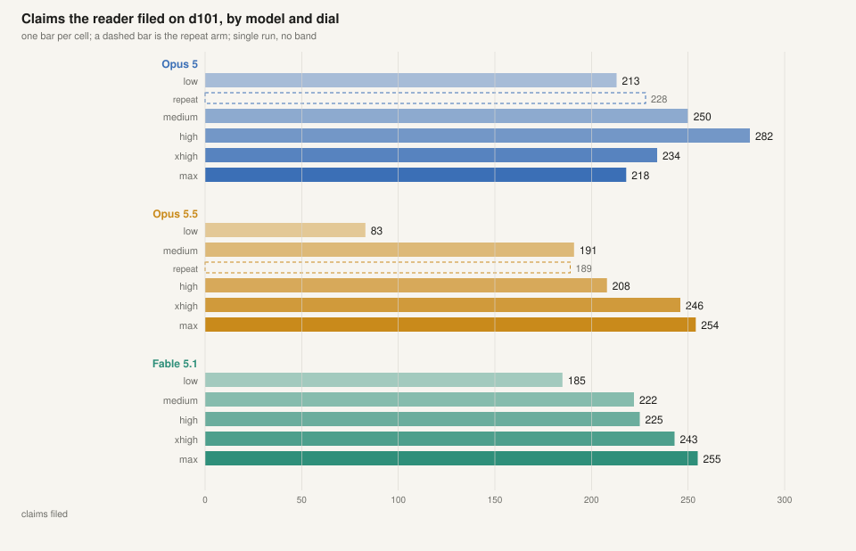

*a count from one run: plain bars, no band; a dashed bar is the repeat arm*

## 06 · One skeptic chair read every claim. It refuted up to 29.6% of Opus 5's claims (32.9% on its repeat arm), 13.3% of Opus 5.5's (4.2% on its repeat arm) and 5.9% of Fable 5.1's.

Every cell's claims went to the same chair, Opus 5.5 at medium, so the cells are graded alike; one grader is still one grader, and where two casts of it disagree both counts are printed. The referees come next. Stats: 63 of 213 (refuted on Opus 5 low, the Opus 5 cell with the largest share); 11 of 83 (refuted on Opus 5.5 low, the Opus 5.5 cell with the largest share); 11 of 185 (refuted on Fable 5.1 low, the Fable 5.1 cell with the largest share); 10 (cells whose plants read “3 of 3” (computed); the rest read 18, pooled).

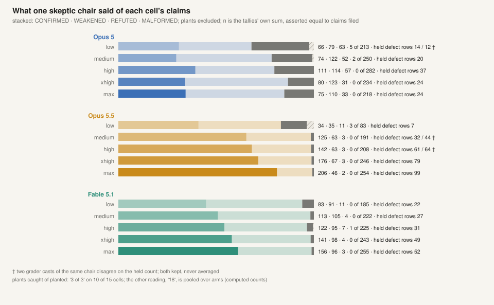

*the four verdicts as a stacked bar per cell; the held defect-row count printed, both casts where two disagree*

## 07 · Two referee families re-derived every held row blind. They agree within four distinct defects on every cell both sat (held rows differ by up to six); on the small cells that is a wide band.

A held number prints per referee, always: TWO FAMILIES, EVERY HELD NUMBER PRINTED PER REFEREE. On this row both families are contestants, and each family refereed cells of its own family as well as the other's; the rule of 2026-10-17 reads: “on a row where Fable is a contestant its neutral standing is SUSPENDED for that row; both families grade and print; the row's ruling reads the non-contestant family (Opus 5.5); the Fable column rides as the calibration band”. As the page's method says, every held count is shown under both, so the filled mark leads every comparison and the hollow mark is Fable's count. Stats: 46 / 47 (distinct held, Opus 5.5 max (Opus 5.5 referee / Fable referee)); 14 / 15 (distinct held, Fable 5.1 low, the holder); 5 / 7 (distinct held, Opus 5 max).

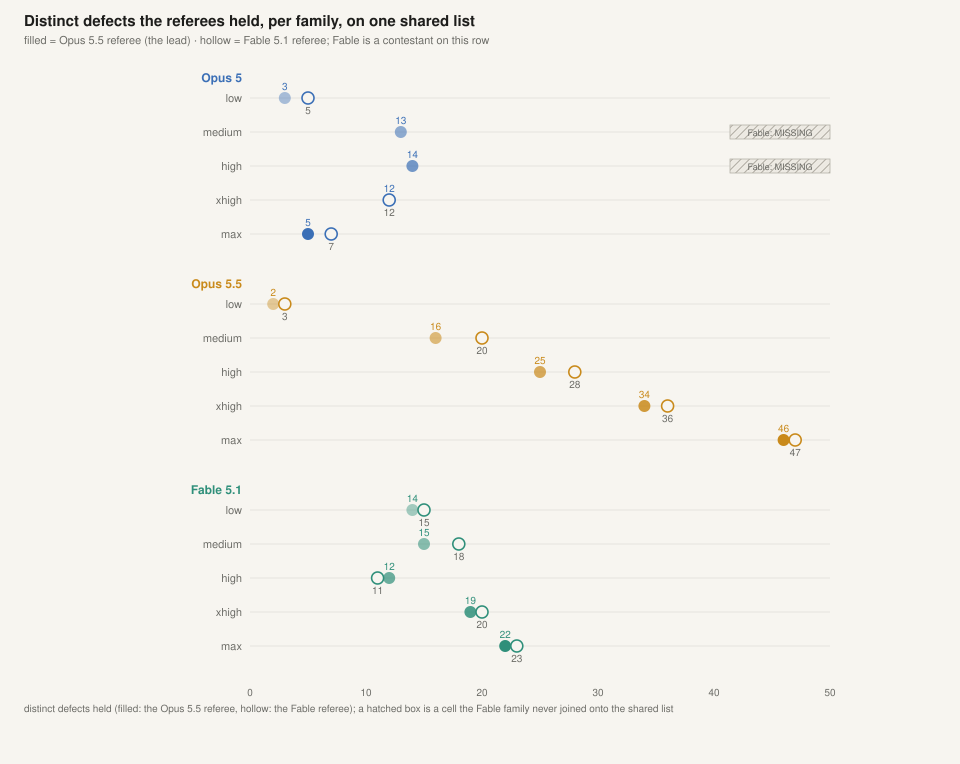

*distinct defects held on one shared list, per referee family; the Fable family's distinct count is MISSING on 3 cells and variants (hatched)*

## 08 · False facts rarely survive; the error every chair makes is the kind.

What a reader gets wrong is charged back against it: a FALSE fact, and a REFILE, a row whose facts hold under the wrong kind, the error no skeptic catches and only a referee names. The most false facts on any cell, under either family, is 2 (computed). Across the cells: 5 / 4 false facts and 146 / 126 wrong kinds, under the Opus 5.5 referee / the Fable referee. A cell a family did not sit adds nothing to that family's total. Stats: 2 / 1 (false facts on Opus 5 high); 13 / 11 (wrong kinds on Opus 5 max, beside only 6 / 9 rows held); 3 / 1 (wrong kinds on Fable 5.1 low, the holder).

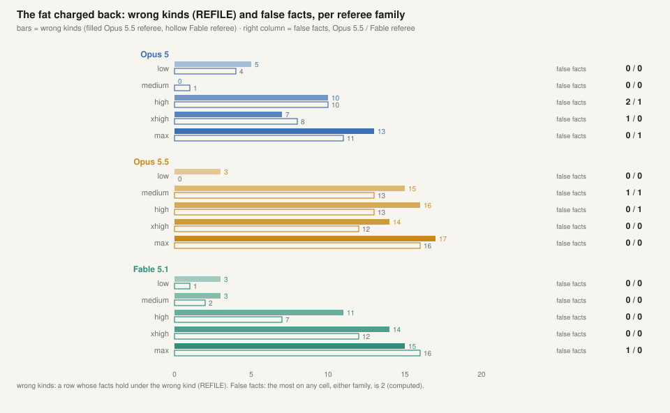

*wrong kinds as paired bars per family; false facts as a digit column, never coloured*

## 09 · The house buys strength per defect, not volume.

The unit is thousands of cache-write tokens per distinct held, per referee family, loaded with the skeptic's and the referee's charge. Dollars are listed as billed where a bill exists, the superseded figure in parentheses, and a hatched POOLED box where one bill covers several cells; 9 of 15 cells have no per-cell bill. Stats: 263k / 260k (per distinct held, Opus 5.5 max); 364k / 341k (per distinct held, Fable 5.1 low, the holder); $70.38 (was $128.74) (list dollars, Opus 5.5 medium, the whole arm incl. its own skeptic).

**Per distinct held.** Thousands of cache-write tokens for each distinct defect held, loaded with the skeptic's and the referee's charge.

| | Opus 5.5 referee / Fable referee |
|---|---|
| Opus 5.5 max, the challenger | 263k / 260k |
| Fable 5.1 low, the holder | 364k / 341k |

**In total.** Millions of cache-write tokens for the whole arm, loaded the same way.

| | Opus 5.5 referee / Fable referee |
|---|---|
| Opus 5.5 max, the challenger | 12.117 / 12.211 |
| Fable 5.1 low, the holder | 5.093 / 5.119 |

On the point estimate the challenger costs less per distinct held, 263k against the holder's 364k, a difference the record reads as NOT SHOWN, inside the repeat pair's loaded-cost spread of 44 percent; in total it costs more, 12.117 million against 5.093 million, on the Opus 5.5 referee's reading.

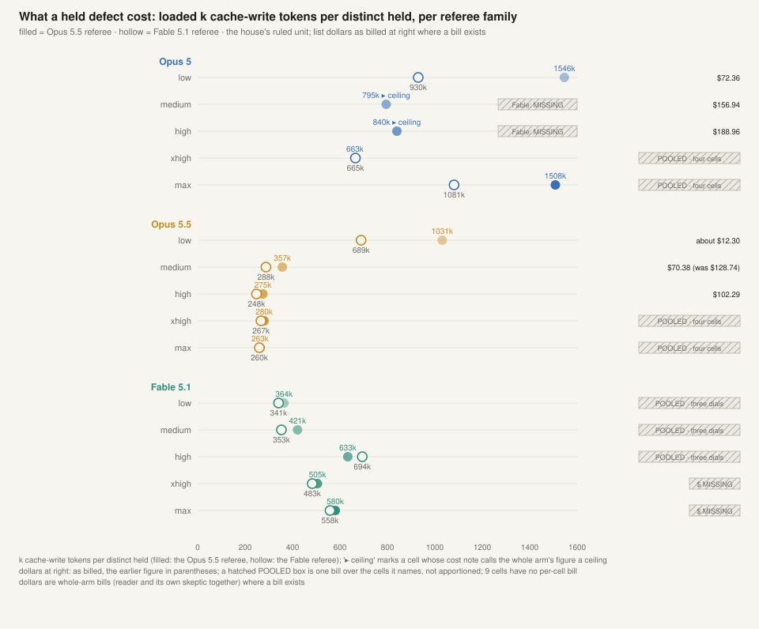

*dots per family; a CEILING flag reads the cell's own annotation; the hatched dollar boxes are cells with no per-cell bill, or with one bill pooled over several cells; the cost in both forms prints above*

## 10 · Under the Opus 5.5 referee: Opus 5.5 rises with the dial, 2 to 46. Fable's five dials span 10 (12 under the Fable referee). Opus 5 reads 14 at high and 5 at max. Single runs; the largest repeat pair on this measure moved 10 held on 16 (11 on 20 under the Fable referee).

The dial is a column of the seats table, set per seat by its job's shape; here the answer differs per model. The Opus 5 against 5.5 rows stand as the release study's reader section; they never decided the holder. Stats: 2 → 16 → 25 → 34 → 46 (Opus 5.5, low to max (Opus 5.5 referee)); 14 → 15 → 12 → 19 → 22 (Fable 5.1, low to max); 3 → 13 → 14 → 12 → 5 (Opus 5, low to max).

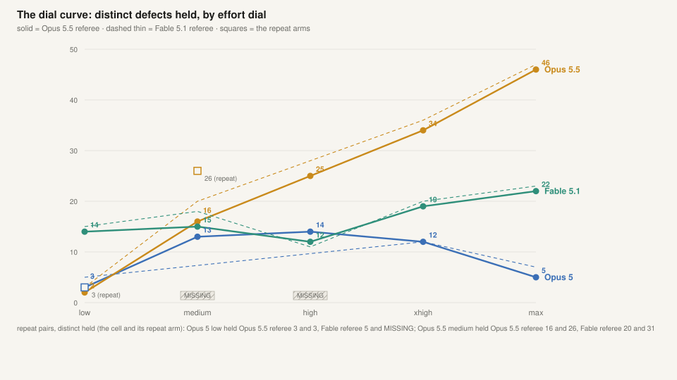

*solid lines the Opus 5.5 referee, thin dashed the Fable referee; the repeat arms as squares; the repeat spread printed from the cells' own margins*

## 11 · Three times the distinct held under either referee. No holder moves on one row.

The holder stands as ruled; the challenger leads on one row, stated under both referee families; the owner placed the challenger for use on that row; the second row is the show's next sitting. Stats: 46 / 47 (distinct held, the challenger (Opus 5.5 max)); 14 / 15 (distinct held, the holder (Fable 5.1 low)); 263k vs 364k (loaded k per distinct held, challenger vs holder, Opus 5.5 referee (Fable referee: 260k vs 341k)).

**HOLDER Fable 5.1 low, ruled by the owner 2026-09-08 and re-affirmed 2026-09-23 after the two readers' findings were laid side by side; “the readers stay on Fable, the desk makes the room” (2026-09-23); STATE CONTESTED [2026-10-24]; CHALLENGER Opus 5.5 max on 2026-10-24: three times the distinct held under either referee; PLACED FOR USE 2026-11-07: 'if i need a skeptic for something we will use opus 5.5 on xhigh, if we need a reader we will use opus 5.5 max, those are already data points we bought, even if incomplete, still offer more data than making that ruling completely blind'; NEXT SITTING three sittings on a tape the house owns, and a new reconciliation of the held defects onto one list (composed on 2026-10-24 and never run)**

| | challenger Opus 5.5 max | holder Fable 5.1 low |
|---|---|---|
| distinct held (Opus 5.5 ref / Fable ref) | 46 / 47 | 14 / 15 |
| loaded k cache-write tokens per distinct held (Opus 5.5 ref / Fable ref) | 263k / 260k | 364k / 341k |
| loaded cost in total, Mtok (Opus 5.5 leg / Fable leg) | 12.117 / 12.211 | 5.093 / 5.119 |
| list dollars as billed | [POOLED: one bill over four cells, not apportioned] | [POOLED: one bill over three dials, not apportioned] |

Single runs; under the Opus 5.5 referee the repeat pair on Opus 5 low held 3 and 3 distinct defects and the pair on Opus 5.5 medium 16 and 26; under the Fable referee 5 and MISSING, and 20 and 31.

## 12 · Ten chairs judged one day's claims: nine over 261 rows, Opus 5.5 high over 259.

One reader arm's claims from day d100 (engine 8.55), with the plants dressed among them, were handed to two models at five dials each. A blind referee then re-graded every row a chair threw out: the skeptic ladder was refereed by one family (Fable 5.1); its counts appear once. Each cell below prints the rows that column threw out. Stats: 10 (skeptic columns); 60 (259) / 61 (261) (rows confirmed, Opus 5.5 high: two populations kept, never averaged); 10 of 10 (columns under one referee family).

| model | low | medium | high | xhigh | max |
|---|---|---|---|---|---|
| Opus 5 | 7 | 10 | 19 / earlier sitting 15 | 23 | 30 |
| Opus 5.5 | 12 | 36 | 41 | 64 | 68 |

- REFILE is MISSING on the ten columns and on the earlier sitting: the ladder's verdict list had no REFILE, and on this ladder that verdict is the referee's. Nine columns were counted over 261 rows; Opus 5.5 high was counted over the 259 claims alone; only Opus 5 high carries an earlier sitting, counted over the 259 claims as well.

## 13 · Opus 5.5 steps at medium and again at xhigh; Opus 5 climbs steadily.

Thrown is REFUTED plus MALFORMED. On Opus 5.5 the dial is monotone in throws and CONFIRMED falls with it; on Opus 5 the slope continues up the ladder. Stats: 12 → 36 → 41 → 64 → 68 (Opus 5.5 rows thrown, low to max); 7 → 10 → 19 → 23 → 30 (Opus 5 rows thrown, low to max); 80 (rows the ruled chair (Opus 5.5 medium) confirmed).

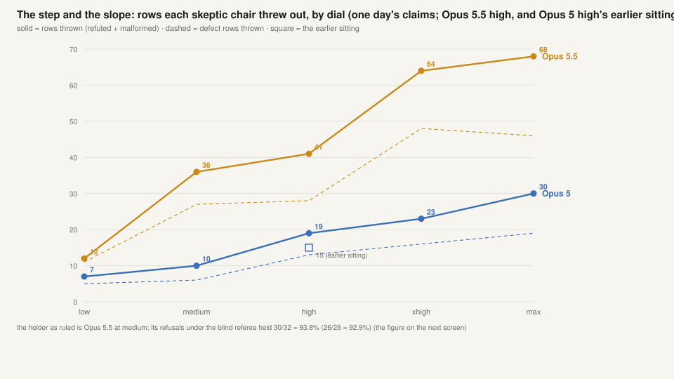

*solid: rows thrown; dashed: defect rows thrown; the earlier Opus 5 sitting at the default dial as a square at high*

## 14 · Mostly, yes. Max throws the most true claims on both models; on Opus 5.5, xhigh ties high and every row only xhigh threw held.

A blind referee graded every thrown row: REFUSAL HOLDS or CLAIM HOLDS. On Opus 5.5's five columns the refusals held 86 to 100 percent; on Opus 5's, 67 to 88 percent. One referee family only; the figure says so in its title. Stats: 30/32 = 93.8% (26/28 = 92.9%) (the ruled chair, Opus 5.5 medium (the page's verdict words; the referee's raw table in parentheses)); 11/11 = 100% (10/10) (Opus 5.5 low); 5/8 = 62.5% (rows only Opus 5.5 max threw: refusal held).

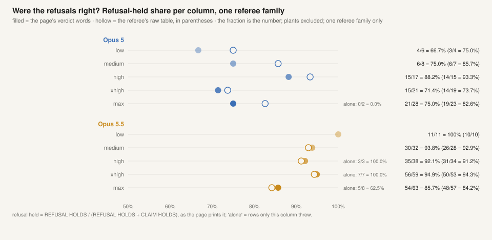

*the page's verdict words filled, the referee's raw table hollow; the fraction beside every dot is the number, read as the page prints it*

## 15 · Per held refusal the challenger costs about the same, 89.6k against medium's 93.3k; its bill is three times medium's, $98.83 against $31.69.

List dollars as billed at list prices, the figure the record printed before re-pricing beside it. The unit per column is k cache-write tokens per held refusal, a division of recorded figures. Stats: $31.69 (was $57.31) (Opus 5.5 medium, the ruled chair); $175.14 (Opus 5.5 max); 93.3 k tokens per held refusal; 77.8 per thrown row (the unit, Opus 5.5 medium, the holder); 89.6 k tokens per held refusal; 78.4 per thrown row (the unit, Opus 5.5 xhigh, the challenger).

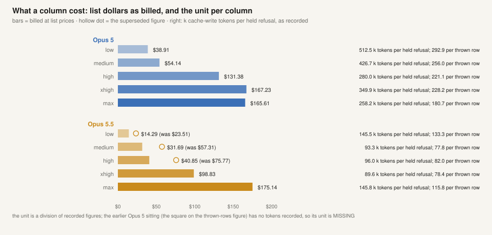

*bars as billed, the hollow dot the superseded figure; at right the unit per column as recorded, hatched where MISSING*

## 16 · 56 refusals held of 64 against medium's 30 of 36. No holder moves on one row.

The holder stands as ruled; the challenger leads on one newer row, under the one referee family bought; the owner placed the challenger for use on that row; the second row is the show's next sitting. Stats: 56 of 64 (refusals held of rows thrown, the challenger (Opus 5.5 xhigh)); 30 of 36 (refusals held of rows thrown, the holder (Opus 5.5 medium)).

**HOLDER Opus 5.5 medium, ruled 2026-09-27; the row quotes no sentence of the owner's; STATE HOLDER; CHALLENGER Opus 5.5 xhigh on the row of 2026-10-18, where every chair's thrown rows were graded by one referee: 56 refusals held of 64 against medium's 30 of 36; PLACED FOR USE 2026-11-07: 'if i need a skeptic for something we will use opus 5.5 on xhigh, if we need a reader we will use opus 5.5 max, those are already data points we bought, even if incomplete, still offer more data than making that ruling completely blind'; NEXT SITTING the upper dials over a second day's claims, with a referee (The second skeptic row is NOT bought this weekend)**

| | challenger Opus 5.5 xhigh | holder Opus 5.5 medium |
|---|---|---|
| refusals held of rows thrown (one referee family) | 56 of 64 | 30 of 36 |
| refusal-held share as the page prints it (the page's verdict words; the raw table in parentheses) | 56/59 = 94.9% (50/53 = 94.3%) | 30/32 = 93.8% (26/28 = 92.9%) |
| cache-write tokens per held refusal | 89.6k | 93.3k |
| list dollars as billed | $98.83 | $31.69 (was $57.31) |

64 and 36 are the rows thrown; 59 and 32 are the thrown rows the referee graded on the page's own verdict words. One referee family: the skeptic ladder was refereed by one family (Fable 5.1); its counts appear once. The rule as applied: every held count where two referee families sat is shown under both.

## 17 · What was bought, what was not, and where both numbers were kept.

A page that cannot trace a figure shows a gap, never a guess. This screen is the census of those gaps, of every disagreement the data keeps as separate entries, and of the rules every chair on this page was read under. Stats: 41 (missing entries); 10 (disagreements kept); 6 (rules the figures ride under).

**The seat rule.** “A chair MOVES on two rows; one row can REFUSE a chair from a seat, and a PLACEMENT into an empty seat is one row plus [the owner's] sentence” (the owner: “seats placed appropriate to job, and the relative strength measure showing us what we're buying”, ruled 2026-09-30).

**The method as applied.** every held count where two referee families sat is shown under both.

**The owner's principle.** “when the reader is opus, the fable referee is the bold one; when it's the fable reader, it's the opus referee”. On this row both families are contestants, so the principle yields to the rule above and the Opus 5.5 referee leads every cell.

**Limitation.** the skeptic ladder was refereed by one family (Fable 5.1); its counts appear once.

**The default chair.** Opus 5.5 at high: “what a seat casts is the newest of a PLACEMENT FOR USE (one row plus his sentence; it may sit over a held seat) or a HOLDER (ruled on two rows); a seat with neither casts THE DEFAULT CHAIR, Opus 5.5 at high, and its row says so; the holder keeps the seat on paper until the second row; a placement is what runs”.

**The referee rule.** TWO FAMILIES, EVERY HELD NUMBER PRINTED PER REFEREE; Opus 5 never referees; a model never referees its own class. On this study's reader row both families were contestants, so the rule could not hold, and both families graded every cell, printed per referee.

| measure | cells and columns with no figure | repeat arms and earlier sittings with no figure |
|---|---|---|
| distinct held, Fable referee | 2 | 1 |
| cost per held, Fable referee, never priced | 2 | 1 |
| the repeat pair's margin | 13 | 0 |
| list dollars | 9 | 0 |
| rows re-filed | 10 | 1 |
| skeptic tokens written | 0 | 1 |
| skeptic list dollars | 0 | 1 |
| the unit per column | 0 | 1 |

## 18 · Built from the record.

Every number on this page is generated from the house's record and checked at every build; the owner answers for any of them in conversation. Every figure carries its gaps and each referee's counts where two sat; nothing on this page is averaged.

## The evaluation card

### What was measured

- The reader seat: a model reads one day of the town's record and files claims, each with the rows behind it; a skeptic chair then tries to refute every claim, and blind referees re-derive the defect rows it holds against the record. The measures are the claims filed, the share the skeptic refuted, the defects each referee family held with each distinct defect counted once, the false facts and wrong kinds among the claims, and the cost of each held defect in cache-write tokens, with list dollars where a bill exists.
- The skeptic seat: a model takes claims one at a time and tries to refute them. The measures are the rows thrown out, the share of those refusals a blind referee upheld, and the cost of each held refusal in cache-write tokens and in list dollars.
- Both seats are read as relative strength: performance and cost, measured together and printed side by side, never one without the other.

### Who sat

- Reader seat: fifteen cells, three models (Opus 5, Opus 5.5 and Fable 5.1) at five effort dials (low, medium, high, xhigh and max), each model at each dial.
- Skeptic seat: ten columns, two models (Opus 5 and Opus 5.5) at five dials (low, medium, high, xhigh and max), each model at each dial.
- Two reader cells were read twice, to show how far one run moves: Opus 5 low, Opus 5.5 medium.

### The material

- One day of the town's record per seat: the reader seat read day d101 and the skeptic seat judged claims drawn from day d100, the days named as the page names them, where a day is one simulated day in which the town's residents think on the wire and every thought, act and dollar lands on a tape.

### Who graded

- Every reader claim went to one skeptic chair, Opus 5.5 at medium; only the defect rows it held were re-derived blind, by two referee families, Fable 5.1 (the neutral family) and Opus 5.5, and every held number is printed per referee.
- On this row both families are contestants, and each family refereed cells of its own family as well as the other's; a contestant's neutral standing is suspended for the row, both families grade and print, and the lead is the Opus 5.5 referee's, as the rule reads.
- Opus 5 never referees; a model never referees its own class. On this study's reader row both families were contestants, so the rule could not hold, and both families graded every cell, printed per referee.

### The limits

- Single runs: each cell is one run, apart from the repeat pairs, and the largest repeat pair on the distinct-held measure moved 10 held on 16 under the Opus 5.5 referee (11 on 20 under the Fable referee); no band is drawn around any other cell.
- The skeptic ladder was refereed by one family (Fable 5.1); its counts appear once. All ten skeptic columns sat under that one family, so no second family checks them.
- Dollars pooled or missing: 9 of 15 reader cells have no per-cell dollar bill, because one bill covers several cells or none was kept, so cost is read in cache-write tokens first and list dollars appear only where a bill exists; ten of ten skeptic columns carry a list-dollar bill.
- Two placements, one row each: no holder moved, and the chair each seat runs changed by placement, the owner having placed a chair for use in each seat, on 2026-11-07 for the reader and on 2026-11-07 for the skeptic, each on one row alone; both holders stand as ruled until a second row.

### The study

- The Cat Show's first study: study one, version 1, from data built on 2026-11-08.
- The owner answers for any figure on request.

[Receipts](glossary.md#a-receipt) for every figure are kept in the house's private record and are available on request.

---

By George.

*generated by the Cat Show's build on 2026-11-08 (data) and 2026-11-08 (page), study one, version 1*
